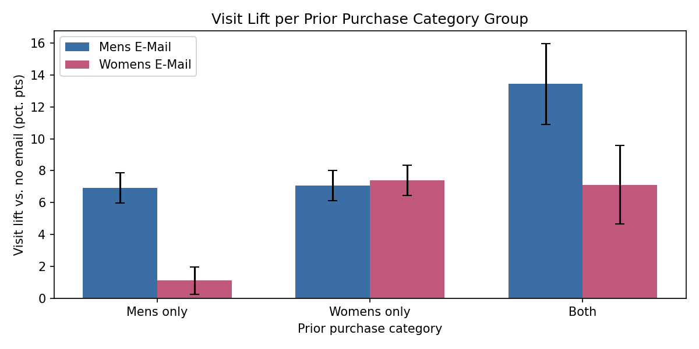

# Email Campaign A/B Test

An end-to-end analysis of a randomized email experiment run by an online retailer, covering experimental design, validation, statistical testing, and a business recommendation.

## Business question
An online retailer tests two merchandise emails (men's and women's) against no email. Should it send a campaign, which version, and to which customers?

## Key results
- **Both emails worked.** Each significantly increased visits, purchases, and revenue vs. no email.
- **The men's email had the larger effect:** conversion rose from 0.57% to 1.25%, about 7 additional buyers and \$770 in additional revenue per 1,000 customers emailed.
- **The women's email only reached part of the audience.** It worked for customers who already buy women's merchandise but had little effect on men's-only buyers, while the men's email lifted every customer type.

## Recommendation
Send the men's email as the default campaign, and run a follow-up test comparing it against sending both emails and against a targeted strategy that matches each customer to the email for their purchase history. 
Key caveats: results reflect these two specific emails, figures are revenue rather than profit, the two emails were each compared to control rather than to
each other, and segment findings are exploratory.

## Methods
- **Pre-registered analysis plan:** hypotheses, metrics, and decision rules committed before viewing outcomes ([analysis_plan.md](analysis_plan.md))
- **Experiment validation:** sample ratio mismatch check (chi-square) and covariate balance (standardized mean differences, chi-square tests)
- **Power analysis:** minimum detectable effects, computed blind to outcomes
- **Hypothesis testing:** two-proportion z-tests with Bonferroni correction for conversion and visits; bootstrap confidence intervals for zero-inflated spend data
- **Segment analysis:** heterogeneous effects by customer type, with a Simpson's paradox check

## Files
- [Full analysis notebook](notebooks/email_ab_test_analysis.ipynb)
- [Analysis plan](analysis_plan.md)

**Data:** [Hillstrom Email Marketing Experiment](https://www.kaggle.com/datasets/sumittarya/hillstrom-email-marketing) (Kevin Hillstrom, MineThatData, 2008). Tools: Python (pandas, SciPy, statsmodels, matplotlib).
